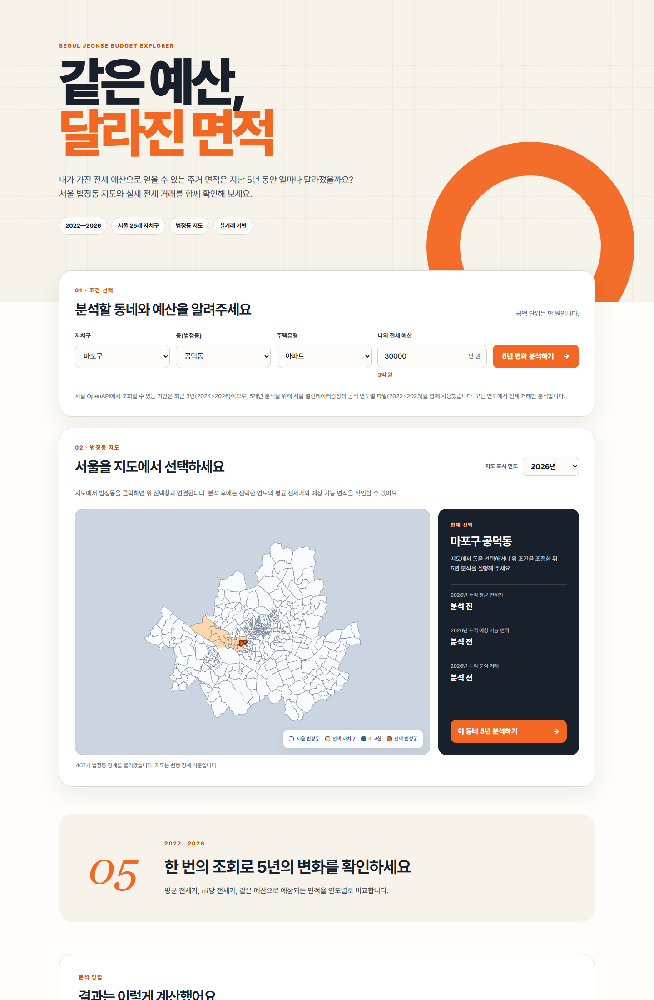

# 같은 예산, 달라진 면적

2022~2026년 서울시 전세 실거래를 이용해 **같은 예산으로 얻을 수 있는 예상 면적이 어떻게 변했는지** 보여주는 과제 2 웹앱입니다.



## 실행 링크

- Cloudflare 앱: <https://seoul-rent-api-dp5.pages.dev/>
- GitHub 저장소: <https://github.com/5ykim/seoul_rent_api>

## 주요 기능

- 자치구, 동(법정동), 주택유형 선택
- 서울 467개 법정동 경계 지도와 지도 클릭 선택
- 지도에서 선택 연도의 평균 전세가·예상 면적·거래 건수 확인
- 2022~2026년 평균 전세가 비교
- 연도별 평균 ㎡당 전세가 계산
- 입력한 예산으로 가능한 예상 면적 계산
- 2022년 대비 2026년 예산 구매력 변화 표시
- 최대 3개 동네의 2026년 예상 면적 비교

## 계산 방법

분석에는 `RENT_SE`가 `전세`인 거래만 사용합니다.

```text
거래별 ㎡당 전세가 = 보증금(GRFE) ÷ 임대면적(RENT_AREA)
평균 ㎡당 전세가 = 거래별 ㎡당 전세가의 평균
예상 가능 면적 = 입력 예산 ÷ 평균 ㎡당 전세가
예상 평수 = 예상 가능 면적 ÷ 3.3058
```

예상 면적은 실제 매물 검색 결과가 아니라 실거래 평균에 근거한 참고값입니다. 2026년 자료는 연중 누적 자료이므로 이전 연도의 전체 자료와 거래 건수를 직접 비교할 때 주의해야 합니다.

## 사용 데이터

- 출처: 서울 열린데이터광장
- 서비스: 서울시 부동산 전월세가 정보 (`tbLnOpendataRentV`)
- 분석 기간: 접수연도 기준 2022~2026년
- 사용 변수: `RCPT_YR`, `CGG_CD`, `CGG_NM`, `STDG_CD`, `STDG_NM`, `RENT_SE`, `RENT_AREA`, `GRFE`, `BLDG_USG`

서울 OpenAPI를 통해 조회할 수 있는 정보는 최근 3년으로 제한됩니다. 따라서 5개년 변화를 조사하기 위해 서울 열린데이터광장의 공식 연도별 파일을 함께 참고했으며, 다음과 같이 분석 기간을 구성했습니다.

- 2022~2023년: 데이터셋 페이지의 공식 연도별 ZIP 파일을 미리 집계한 `data/historical-summary.js`
- 2024~2026년: Cloudflare Pages Function이 서울 OpenAPI에서 실시간 조회

두 자료 모두 같은 서울시 데이터셋이며 같은 변수와 계산식을 사용합니다.

API의 `STDG_NM`은 행정동이 아니라 **법정동명**이므로 앱에서도 `동(법정동)`으로 표기했습니다.

### 법정동 지도 데이터

- 출처: 국토교통부 국가공간정보센터 [「법정구역정보(WMS/WFS)」](https://www.data.go.kr/data/15123903/openapi.do)
- 수집 서비스: 서울특별시 공식 GeoServer `LSMD_ADM_SECT_UMD`
- 이용조건: 공공저작물 출처표시 제1유형
- 좌표계: EPSG:4326
- 가공일: 2026-10-16

공식 경계를 웹에서 빠르게 보여주기 위해 도형을 단순화하고 좌표 정밀도를 조정했습니다. 원본 8자리 `EMD_CD`에 `00`을 붙인 10자리 법정동 코드를 `CGG_CD + STDG_CD`와 연결합니다. 이름이 같은 동이 여러 자치구에 있어도 코드로 구분됩니다.

지도는 현행 법정동 경계로 위치를 보여주고, 전세 값은 서울 열린데이터광장의 연도별 거래에서 계산합니다. 서울 전체 동을 페이지가 열릴 때마다 API로 조회하지 않고, 선택한 동의 5개년 값만 불러와 API 호출량과 로딩 시간을 줄였습니다.

## 파일 구성

```text
seoul_rent_api/
├─ index.html                 화면 구조
├─ styles.css                밝은 배경과 오렌지 포인트 디자인
├─ app.js                    선택 메뉴, 법정동 지도, 계산 결과, Plotly 차트
├─ data/seoul-legal-dongs.geojson  서울 법정동 경계
├─ data/regions.json         자치구·법정동 코드 목록
├─ data/historical-summary.js 2022~2023년 공식 파일 집계값
├─ functions/api/rent.js     서울 API 호출과 연도별 평균 계산
├─ scripts/build-history.mjs 과거 연도 파일 집계 도구
├─ scripts/build-regions.mjs 지역 목록 생성 도구
├─ test/rent.test.js         계산 함수 테스트
├─ test/map.test.js          지도 경계·법정동 코드 테스트
├─ _routes.json              /api 경로에만 Function 적용
└─ wrangler.toml             Cloudflare Pages Function 설정
```

## API 키 보안

실제 API 키를 `index.html`, `app.js`, `README.md`에 입력하지 않습니다. 브라우저는 프로젝트의 `/api/rent`만 호출하고, Cloudflare Pages Function이 서버에서 `SEOUL_API_KEY`를 사용합니다.

로컬 테스트가 필요하면 `.dev.vars.example`을 복사하여 `.dev.vars`를 만들고 본인의 키를 입력합니다.

```text
SEOUL_API_KEY=본인의_API키
```

`.dev.vars`와 `.env`는 `.gitignore`에 등록되어 GitHub에 올라가지 않습니다. 실제 키를 채팅이나 공개 저장소에 붙여 넣지 마세요.

## Cloudflare Pages 배포

1. GitHub에 `seoul_rent_api` 저장소를 만들고 이 폴더의 파일을 올립니다.
2. Cloudflare의 **Workers & Pages**에서 **Create application → Pages → Connect to Git**을 선택합니다.
3. GitHub의 `seoul_rent_api` 저장소를 연결합니다.
4. 빌드 설정은 다음과 같이 입력합니다.

| 항목 | 값 |
| --- | --- |
| Framework preset | None |
| Build command | 비워 두기 |
| Build output directory | `/` |

5. 프로젝트의 **Settings → Variables and Secrets**에서 다음 값을 추가합니다.

| 항목 | 값 |
| --- | --- |
| Variable name | `SEOUL_API_KEY` |
| Value | 본인의 서울 열린데이터 API 키 |
| Type | Encrypt(Secret) |

6. 저장 후 다시 배포합니다.

서울 API는 공식 주소의 `8088` 포트를 사용합니다. `wrangler.toml`에는 이 주소를 호출하기 위한 `allow_custom_ports` 호환 설정이 포함되어 있습니다.

## 테스트

API 키 없이도 평균 계산과 입력값 검사 테스트를 실행할 수 있습니다.

```text
npm test
```

2022~2023년 집계값은 API 키 없이 조회할 수 있습니다. 실제 5개년 전체 조회는 2024~2026년 API 호출을 위해 서울 열린데이터 API 키를 Cloudflare에 등록한 뒤 확인합니다.

